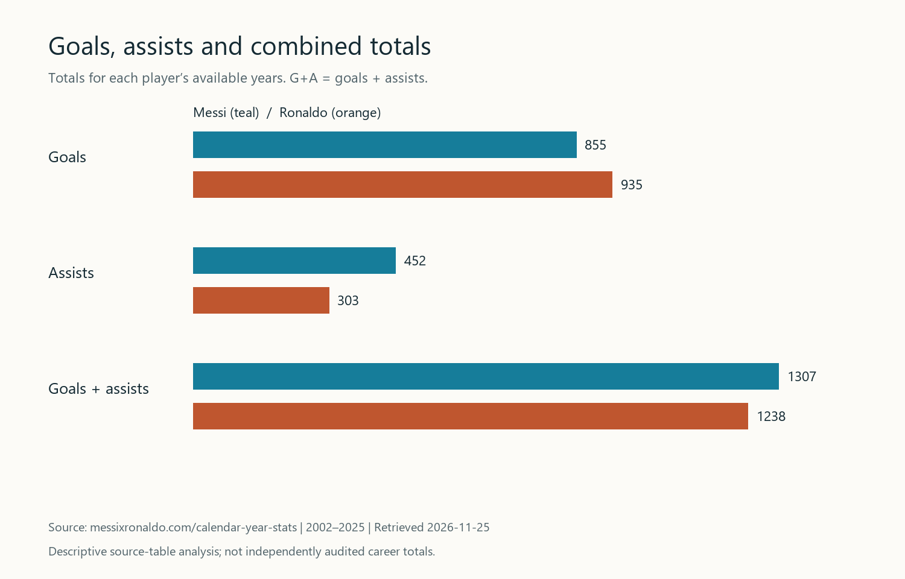
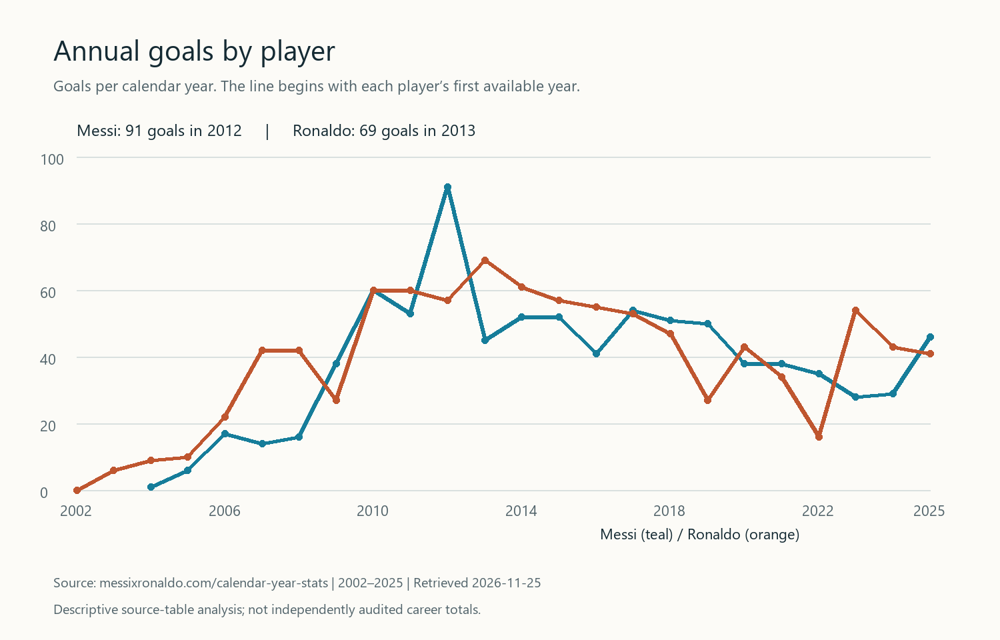

# Messi vs Ronaldo: how the metric changes the story

An extension of my CISC7204 Practice 07 visualization, prepared for Practice 09.
Author: **LI SIWEI** · Status: **ongoing** (independent source validation).

## Research question

How does the apparent leader change when we compare goals, assists, and goals
plus assists, and how do annual peaks differ from sustained scoring?

## Data source and usage permissions

- Source: [MessiXRonaldo calendar-year table](https://messixronaldo.com/calendar-year-stats).
- Scope: 24 calendar years, 2002–2025, senior club and international statistics
  as represented by this source. The current figures use the table retrieved on 25 November 2026.
- [Source methodology](https://messixronaldo.com/methodology) describes a broad
  historical assist definition. That definition can differ from other trackers.
- The source is publicly readable, but an explicit open-data reuse license was
  not found on the inspected pages. Public availability is not an open license.
  **No raw dataset, source HTML, photographs, or website assets are redistributed.**
  The script reads the public table on demand; use remains subject to the
  source's terms. The original code and derived, attributed charts are shared
  as coursework. This repository does not grant rights to third-party data.
- Only aggregate professional sports statistics are used. No credentials,
  private contact details, or restricted course datasets are included.
- For unrestricted downstream reuse, first establish data permission or replace
  the source with an explicitly licensed dataset.

## Methods and tools

Python standard-library HTML parsing, schema validation, deterministic aggregation,
and Pillow chart rendering. Missing pre-debut Messi observations remain missing;
they are excluded from his totals and the annual line. Neither player receives
invented observations. The incomplete 2026 calendar year is excluded.
Each player's own available years are used; career durations are unequal.
G+A assigns equal weight to goals and assists as a descriptive choice.
No hypothesis test, causal inference, or predictive model is claimed.

## Key findings — for this source snapshot only

| Measure | Messi | Ronaldo |
|---|---:|---:|
| Goals | 855 | 935 |
| Assists | 452 | 303 |
| Goals + assists | 1,307 | 1,238 |
| Appearances | 1,076 | 1,181 |
| G+A per appearance | 1.215 | 1.048 |
| Years with at least 40 goals | 11 | 15 |

Ronaldo leads by **80 goals**, while Messi leads by **69 goals plus assists**.
Messi's highest annual value is **91 (2012)**; Ronaldo's is **69 (2013)**.
The choice of metric changes which player leads.





## Limitations and next steps

These calculations reproduce a fan-maintained source table; they do not verify
the accuracy of that table. Annual figures require independent match-level
auditing before use as authoritative career statistics. Assist definitions,
unequal career windows, minutes, league strength, roles, and competition mix
affect interpretation. Per-appearance rates do not adjust for minutes played.
Following peer feedback, the scope is now explicit: **dribbling is not measured,
and penalty goals are not separated from non-penalty goals**. The selected metrics
cannot represent every aspect of either player's performance.
Next: cross-check annual records, resolve reuse permissions, compare a common
time window, and consider dribbling and penalty/non-penalty breakdowns if reliable,
consistently defined data become available.

## Reproduce

Requires Python 3.10+ and Internet access to the public source on the first route.

```sh
python -m venv .venv
# Windows PowerShell: .venv\Scripts\Activate.ps1
# macOS/Linux: source .venv/bin/activate
python -m pip install -r requirements.txt
python scripts/analyze.py
```

The script creates `results.json` and both PNG files in `figures/`.
No sign-in or API key is needed. It validates all years, missingness, nonnegative
counts, and a SHA-256 hash of normalized observations. If the source changes,
the script stops rather than silently producing different published results.
Review the new source before changing the expected hash or findings.

If you have a lawfully obtained local CSV matching either documented snapshot, run:

```sh
python scripts/analyze.py --data path/to/calendar_year_stats.csv
```

Schema: `year,messi_goals,messi_assists,messi_apps,ronaldo_goals,ronaldo_assists,ronaldo_apps`.
Empty cells are missing values. The local CSV is intentionally ignored by Git.
The default online route expects the 25 November 2026 normalized SHA-256
`3246295a5b0970b3b2037c0dead2ab084795a8626d562fc83f65131d9e6829d8`.
On that date the checked script fetched the table, passed this hash check and
regenerated the published figures and totals with Python 3.10.15 and Pillow 10.4.0.

### Why the October post gives different totals

The source revised observations for 2022–2025 between the two retrievals.
The twenty rows for 2002–2021 matched. The 21 October snapshot gave Ronaldo a
79-goal lead and Messi a 71-contribution lead. The revised table gives margins
of 80 and 69. The coverage dates and counting method are the same.
The updated script also reproduced the October totals from a local CSV with hash
`bb4fff0129c81656889772206fb58e40acb6456d27db8ddec052483d47d1de3f`.
Each run writes its snapshot date to the two figures and to `results.json`.
The [October release](https://github.com/LISIWEI-UM/data-science-project/tree/9f4ac0b3d1672b9e8b12fb8e913a55603e6a7b85)
preserves the original results and charts.

## Peer review

Feedback relayed by the author identified limited metric coverage. The portfolio
and this README now explicitly discuss excluded dribbling and penalty breakdowns.
See [PEER_REVIEW.md](PEER_REVIEW.md) for the feedback and the resulting revision.

## AI assistance

The October Practice 09 release used GPT-6 in Codex to reorganize the earlier
AI-assisted Practice 07 analysis, write code, draw charts and draft the portfolio.
For the November release, Codex compared the two source snapshots, updated the
checks and chart annotations, reran both analysis routes and revised the documentation.
